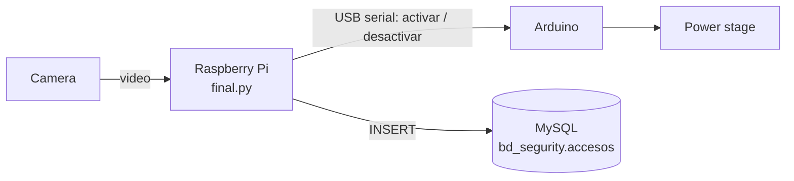

# Face Recognition Access Control

An access control system that recognizes a person's face with a camera and, if they are authorized, tells an Arduino to activate a power stage (for example, a relay driving a lock). Each recognition is logged to a MySQL database.

It runs on a **Raspberry Pi** with Python and OpenCV. The Arduino only handles the power stage.

> [!WARNING]
> This is an educational prototype. It has no liveness detection, so a photo of an authorized person could unlock it. Read [Known limitations](#known-limitations) before using it to protect anything real.

## How it works



For each camera frame, `final.py`:

1. Converts the frame to grayscale and detects faces with OpenCV's Haar cascade.
2. Crops each face and resizes it to 150×150.
3. Compares it with the trained **LBPH** model, which returns a label and a distance. A lower distance means a closer match.
4. If the distance is **below 70**, the person is recognized: it sends `activar` to the Arduino and logs the name and time.
5. Otherwise, it shows "Desconocido" (unknown) and sends `desactivar`.

After each face it waits one second. Press **ESC** to quit.

## Project structure

| File | Purpose | Runs on |
|---|---|---|
| `capturandoRostros.py` | Step 1: captures 300 face images of one person | PC or Raspberry Pi |
| `entrenandoRF.py` | Step 2: trains the model and writes `modeloLBPHFace.xml` | PC or Raspberry Pi |
| `ReconocimientoFacial.py` | Test: recognition only, useful for tuning the threshold | Windows |
| `ReconocimientoConSQL.py` | Test: recognition and MySQL, without the Arduino | Windows |
| `final.py` | Complete system: recognition, MySQL and Arduino | Raspberry Pi |
| `esquema.sql` | Creates the database and the `accesos` table | – |
| `requirements.txt` | Python dependencies | – |
| `BD/sql.py` | Standalone MySQL experiment; not part of the system | – |

**Not included:** the face images (`Data/`), the trained model (`modeloLBPHFace.xml`) and the Arduino sketch. The first two are generated in the steps below.

## Requirements

### Hardware

- Raspberry Pi with Raspberry Pi OS and a display
- Camera available as video device 0
- Arduino connected over USB (`/dev/ttyACM0`)
- Power stage driven by the Arduino (relay, optocoupler, etc.)

### Software

- Python 3
- MySQL or MariaDB
- The packages in `requirements.txt`

Use `opencv-contrib-python`, not `opencv-python`: the face recognizer (`cv2.face`) is only in the contrib build, and the two packages conflict.

### Arduino protocol

You need to write a sketch that listens at **9600 baud** for ASCII text with **no line ending**:

| Message | Action |
|---|---|
| `activar` | Turn the power stage on |
| `desactivar` | Turn the power stage off |

## Installation (Raspberry Pi)

```bash
# System packages (skip libatlas-base-dev if your OS release does not provide it)
sudo apt update
sudo apt install -y python3-venv python3-pip mariadb-server libatlas-base-dev

# Serial port access; log out and back in afterwards
sudo usermod -a -G dialout $USER

# Project and virtual environment
git clone https://github.com/CrisGP14/Control-De-Acceso-Con-Reconociemiento.git /home/pi/Desktop/Reconocimiento
cd /home/pi/Desktop/Reconocimiento
python3 -m venv venv
source venv/bin/activate
pip install -r requirements.txt

# Database
sudo mysql < esquema.sql
```

## Configuration

Settings are written directly in the scripts. Edit them before running:

| Setting | Where | Notes |
|---|---|---|
| `dataPath` | all scripts except `BD/sql.py` | `final.py` uses `/home/pi/Desktop/Reconocimiento/Data`; the others use a Windows path |
| `personName` | `capturandoRostros.py` | Name of the person to register |
| Database connection | `final.py`, `ReconocimientoConSQL.py` | Replace the default credentials. Prefer a dedicated user with only `INSERT` permission on `accesos` |
| Serial port | `final.py` | Default `/dev/ttyACM0` |
| Recognition threshold | recognition scripts | Default `70`; lower is stricter |

## Usage

Run every script from the project folder, because the model path is relative.

```bash
# 1. Set personName, then capture 300 images (ESC stops early). Repeat for each person.
python3 capturandoRostros.py

# 2. Train the model with everyone in Data/
python3 entrenandoRF.py

# 3. Run the system
python3 final.py
```

Images are stored with one folder per person:

```text
Data/
└── <name>/
    ├── rotro_0.jpg
    └── ...
```

> [!IMPORTANT]
> Names come from the folder order in `Data/`. After adding, removing or renaming a folder, retrain **on the machine that will run the system**, or the wrong name may be shown and logged. Keep only person folders inside `Data/`.

## Privacy

Face images and trained models are biometric data. `.gitignore` excludes `.jpg`, `.jpeg`, `.png` and `.xml` files so they are not committed. Get each person's consent before registering them.

## Known limitations

- [ ] No liveness detection: a photo or video could fool the system.
- [ ] The power stage is not turned off when nobody is in view. `desactivar` is sent only when an unknown face is detected.
- [ ] Database credentials are hardcoded in the scripts.
- [ ] SQL queries are built with `.format()` instead of parameters.
- [ ] A new record is inserted repeatedly while a recognized face stays in view.
- [ ] Paths are hardcoded.
- [ ] The Arduino sketch is not included.
